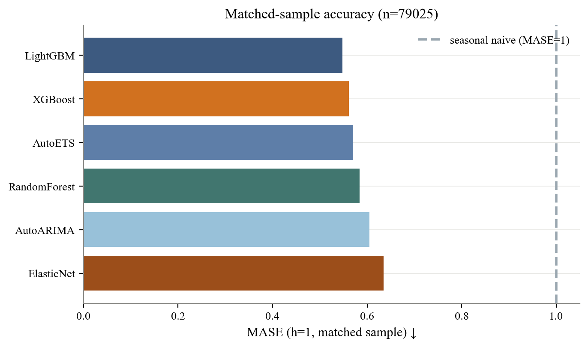
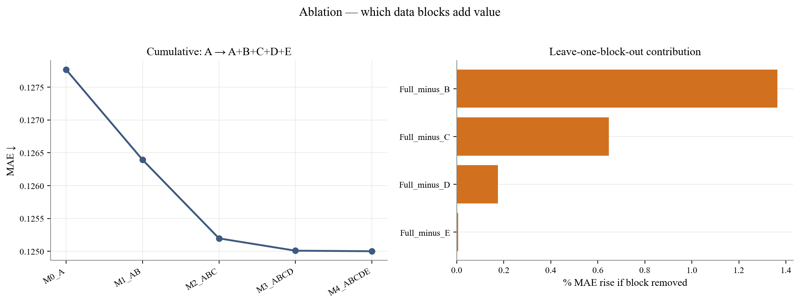

# Forecasting Firm Revenue with Machine Learning

Out-of-sample forecasting of quarterly firm revenue with a rolling-window pipeline. Statistical, linear, tree-based and deep-learning models are benchmarked against ARIMA/ETS and analyst consensus, and the forecast gap is tested in a long-short portfolio.

> Data (WRDS, I/B/E/S) is licensed and **not included**. Only code and aggregate figures are published.

## Pipeline


## Highlights

- Target: seasonal log revenue growth.
- Leakage control: availability dates per firm-quarter, training-window-only preprocessing, forward validation.
- Evaluation: matched-sample MASE, Diebold–Mariano tests, feature-block ablation, SHAP.
- Stack: statsforecast, mlforecast, neuralforecast, scikit-learn, LightGBM, XGBoost, PyTorch.

## Results




## Layout

```
as_fin/      features · models · pipeline · evaluation · utils
scripts/     entry points
config.yaml  settings
```
